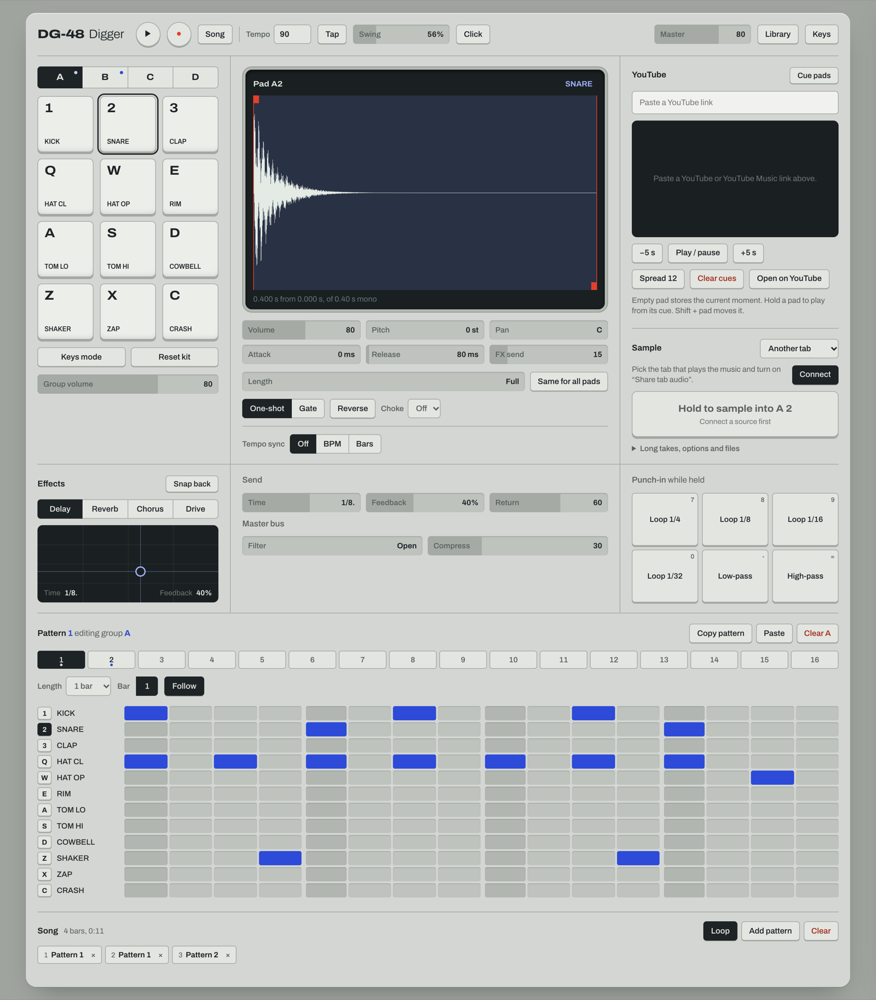

<h1 align="center">DG-48 Digger</h1>

<p align="center">
  브라우저에서 쓰는 포켓 샘플러. 소리를 찾아 패드에 잘라 넣고 비트를 만들어 보세요.
</p>

<p align="center">
  <a href="https://jhwoo582.github.io/DG-48/"><b>앱 열기</b></a>
  &nbsp;|&nbsp; <a href="README.md">English</a>
  &nbsp;|&nbsp; 한국어
</p>

<p align="center">
  
</p>

## 바로 써보기

1. Chrome이나 Edge에서 [앱을 열고](https://jhwoo582.github.io/DG-48/) **Turn on audio**를 누르세요.
2. `Space`를 누르면 데모 비트가 나옵니다.
3. `1 2 3` `Q W E` `A S D` `Z X C`로 패드를 치고, 아래 그리드를 클릭해서 스텝을 찍어 보세요.

작업한 내용은 브라우저에 자동으로 저장됩니다.

## 샘플링

**다른 탭에서 (YouTube, YouTube Music 등 소리가 나는 탭이면 다 됩니다)**

1. **Sample**에서 소스를 **Another tab**으로 두고 **Connect**를 누릅니다.
2. 소리가 나는 탭을 고르고 **탭 오디오 공유**를 켭니다.
3. 원하는 구간이 나오는 동안 **빨간 버튼**(또는 `G`)을 누르고 있다가 떼면 패드에 들어갑니다.
   짧게 누르면 직전 4초가 들어가요. 최근 60초는 항상 버퍼에 남아 있어서 조금 늦게 눌러도 됩니다.

녹음한 뒤에는 파형의 빨간 마커를 끌어서 trim 하거나, **Chop**으로 잘라 여러 패드에 나눠 담을 수 있어요.

**Library에서**

**Library**(`L`)를 열면 클래식 드럼 머신, 실제 악기 샘플, Freesound를 둘러볼 수 있습니다. ▶로 들어 보고 **Add**를 누르거나 패드로 끌어다 놓으면 됩니다.

## 기능

| | |
| --- | --- |
| **Pads** | 12 pads × 4 groups. 기본 키트는 코드로 합성하기 때문에 저장소에 오디오 파일이 없습니다. |
| **Shape** | Trim, volume, pitch, pan, attack, release, reverse, choke group. One-shot / Gate 모드. |
| **Length** | 템포에 맞춘 음표 길이(1/32 ~ 1 bar)로 소리를 자릅니다. 버튼 하나로 그룹 전체에 적용할 수 있어요. |
| **Tempo sync** | 루프를 원래 BPM에서 프로젝트 BPM으로 맞추거나 마디 수에 맞춥니다. Stretch(음정 유지)와 Repitch(테이프 방식) 중 선택. |
| **Chop** | 샘플을 균등하게, 또는 transient마다 잘라 다음 패드들에 넣습니다. |
| **YouTube cue pads** | 링크를 붙여넣으면 패드마다 영상의 cue 지점이 하나씩 잡힙니다. 패드를 누르고 있는 동안 그 지점부터 재생돼요. |
| **Sequencer** | 최대 4 bars짜리 pattern 16개. pattern 하나에 네 그룹이 모두 들어갑니다. Live record, swing, metronome, song chain 지원. |
| **Effects** | Send로 거는 delay, reverb, chorus, drive와 XY pad. Master filter, compressor, punch-in loop / filter. |
| **편의 기능** | Undo / redo, 모든 슬라이더에서 트랙패드 스와이프, 한글 입력 상태에서도 먹히는 단축키. |

## 단축키

| 키 | 동작 |
| --- | --- |
| `1 2 3` `Q W E` `A S D` `Z X C` | Pads |
| `Space` | 재생 / 정지 |
| `G` | 누르고 있으면 샘플링, 짧게 누르면 직전 4초 |
| `↑` `↓` | Group 변경 |
| `[` `]` | Pattern 변경 |
| `R` | Pattern에 live record |
| `N` | Song mode |
| `K` | Keys mode (소리 하나를 음계로 연주) |
| `Y` | YouTube cue pads |
| `L` | Library |
| `T` | Tap tempo |
| `M` | Metronome |
| `7 8 9 0 - =` | Punch-in effects |
| `⌘Z` / `⇧⌘Z` | Undo / redo |
| `?` | 전체 단축키 보기 |

트랙패드로 패드 위를 위아래로 쓸면 volume, 좌우로 쓸면 FX send가 바뀝니다.

## 로컬에서 실행

Node.js 18 이상이 필요합니다.

```bash
npm install
npm run dev
```

`npm run build`를 실행하면 `dist/`에 정적 사이트가 만들어집니다. `main`에 push하면 `.github/workflows/deploy.yml`이 GitHub Pages에 자동으로 배포해요.

## 소리 출처와 라이선스

저장소에는 외부 오디오 파일이 들어 있지 않습니다. Library의 소리는 사용할 때 원래 출처에서 불러옵니다.

| 출처 | 라이선스 |
| --- | --- |
| [Versilian Community Sample Library](https://github.com/sgossner/VCSL) | CC0 |
| [tidal-drum-machines](https://github.com/ritchse/tidal-drum-machines) | 명시돼 있지 않음. 이 소리로 만든 곡을 공개하기 전에 확인하세요. |
| [Freesound](https://freesound.org) | 소리마다 다름 (CC0, CC BY, CC BY-NC). 검색 결과에 함께 표시됩니다. |

샘플 목록은 [felixroos/dough-samples](https://github.com/felixroos/dough-samples)에서 가져옵니다. Freesound 검색을 쓰려면 [freesound.org/apiv2/apply](https://freesound.org/apiv2/apply)에서 무료 API key를 발급받아 넣으면 됩니다. Key는 내 브라우저에만 저장돼요.

## 참고

- 앱 안의 YouTube 플레이어는 cue pads 용도로만 쓰고, YouTube 개발자 정책에 따라 그 소리는 녹음하지 않습니다. 녹음해서 공개하는 소리의 저작권은 각자 확인해 주세요.
- Chrome과 Edge에서 가장 잘 돌아갑니다. Safari와 Firefox는 탭 오디오 공유를 지원하지 않아요.
- Teenage Engineering EP-133 K.O. II 같은 소형 하드웨어 샘플러의 작업 흐름에서 영감을 받았습니다. Teenage Engineering과는 관련 없는 개인 취미 프로젝트입니다.

## 라이선스

[MIT](LICENSE)
