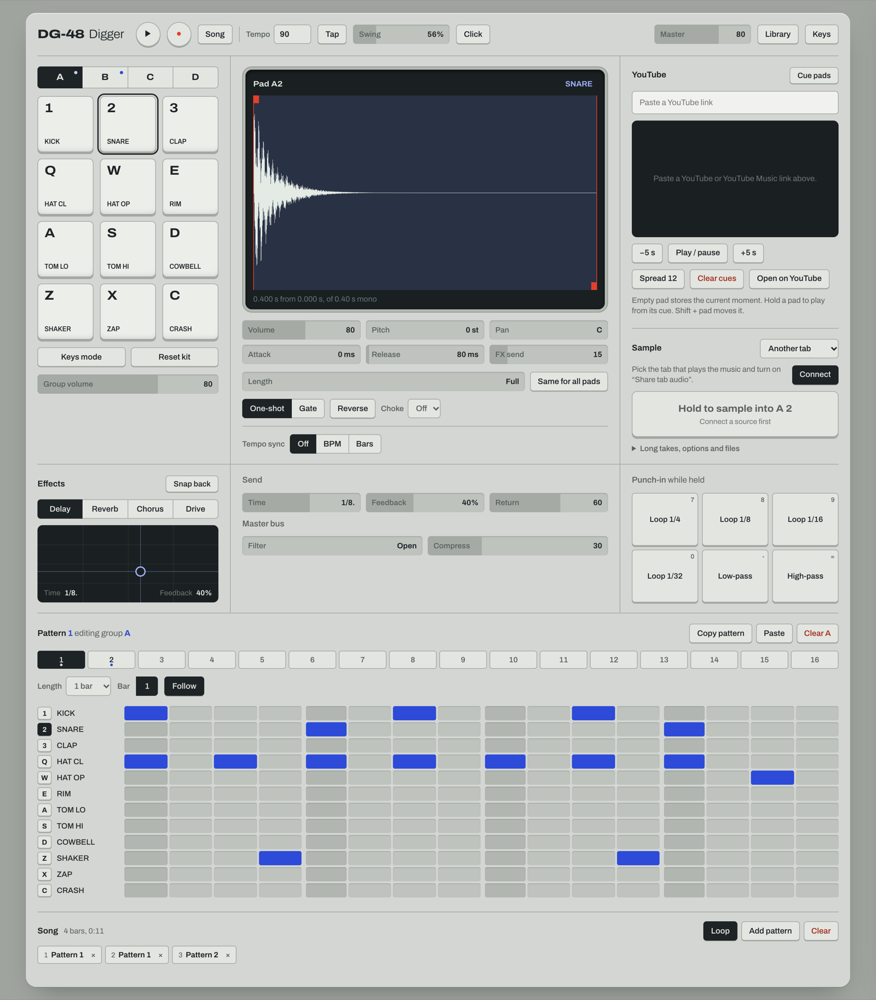

<h1 align="center">DG-48 Digger</h1>

<p align="center">
  A pocket sampler for the browser. Dig for sounds, chop them onto pads, build beats.
</p>

<p align="center">
  <a href="https://jhwoo582.github.io/DG-48/"><b>Open the app</b></a>
  &nbsp;|&nbsp; English
  &nbsp;|&nbsp; <a href="README.ko.md">한국어</a>
</p>

<p align="center">
  
</p>

## Try it in 30 seconds

1. [Open the app](https://jhwoo582.github.io/DG-48/) in Chrome or Edge and click **Turn on audio**.
2. Press **Space** to play the demo beat.
3. Hit the pads with `1 2 3` `Q W E` `A S D` `Z X C`, and click the grid to add steps.

Everything you make is saved in your browser.

## Sample something

**From any tab (YouTube, YouTube Music, anything that plays sound)**

1. In **Sample**, keep the source on **Another tab** and press **Connect**.
2. Pick the tab that's playing and turn on **Share tab audio**.
3. **Hold the red button** (or `G`) while the part you want plays. Let go and it lands on the pad.
   Just tap it to keep the last 4 seconds. The last 60 seconds are always buffered, so reacting late is fine.

Then drag the red markers on the waveform to trim, or use **Chop** to slice it across pads at each hit.

**From the library**

Press **Library** (`L`) to browse classic drum machines, real instruments and Freesound. Preview with ▶, then press **Add** or drag a sound onto a pad.

## Features

| | |
| --- | --- |
| **Pads** | 12 pads × 4 groups. Built-in kits are synthesized in code, so the app ships no audio files. |
| **Shape** | Trim, volume, pitch, pan, attack, release, reverse, choke groups. One-shot or gate. |
| **Length** | Cut sounds at a note length (1/32 to 1 bar) that follows the tempo. One click applies it to the whole group. |
| **Tempo sync** | Stretch a loop from its own BPM to yours, or fit it to bars. Keeps pitch, or works like tape. |
| **Chop** | Slice a sample onto the next pads, evenly or at each hit. |
| **YouTube cue pads** | Paste a link and turn the pads into cue points in the video. Hold a pad to play from its cue. |
| **Sequencer** | 16 patterns of up to 4 bars, each holding all four groups. Live record, swing, metronome, song chain. |
| **Effects** | Delay, reverb, chorus or drive on a send with an XY pad. Master filter and compressor. Punch-in loops and filters. |
| **Comfort** | Undo and redo, trackpad swipes on every slider, keys that work in any input language. |

## Keyboard

| Keys | Action |
| --- | --- |
| `1 2 3` `Q W E` `A S D` `Z X C` | Pads |
| `Space` | Play / stop |
| `G` | Hold to sample, tap for the last 4 s |
| `↑` `↓` | Group |
| `[` `]` | Pattern |
| `R` | Record into the pattern |
| `N` | Song mode |
| `K` | Keys mode (play one sound chromatically) |
| `Y` | YouTube cue pads |
| `L` | Library |
| `T` | Tap tempo |
| `M` | Metronome |
| `7 8 9 0 - =` | Punch-in effects |
| `⌘Z` / `⇧⌘Z` | Undo / redo |
| `?` | All shortcuts |

On a trackpad, swipe over a pad to change its volume (up and down) or FX send (sideways).

## Run it locally

Requires Node.js 18 or newer.

```bash
npm install
npm run dev
```

`npm run build` writes a static site to `dist/`. Every push to `main` deploys it to GitHub Pages through `.github/workflows/deploy.yml`.

## Sounds and licenses

The repository contains no third-party audio. Library sounds are fetched from their original sources when you use them.

| Source | License |
| --- | --- |
| [Versilian Community Sample Library](https://github.com/sgossner/VCSL) | CC0 |
| [tidal-drum-machines](https://github.com/ritchse/tidal-drum-machines) | Not stated. Check before releasing music made with these. |
| [Freesound](https://freesound.org) | Per sound (CC0, CC BY, CC BY-NC), shown next to each result |

Sample lists come from [felixroos/dough-samples](https://github.com/felixroos/dough-samples). Freesound search needs your own free API key from [freesound.org/apiv2/apply](https://freesound.org/apiv2/apply). The key stays in your browser.

## Notes

- The embedded YouTube player is only used for cue pads. Its audio is never recorded, in line with YouTube's developer policies. You are responsible for having the rights to anything you record and release.
- Works best in Chrome and Edge. Tab audio sharing is not available in Safari or Firefox.
- The workflow is inspired by small hardware samplers such as the Teenage Engineering EP-133 K.O. II. This is an independent hobby project, not affiliated with Teenage Engineering.

## License

[MIT](LICENSE)
